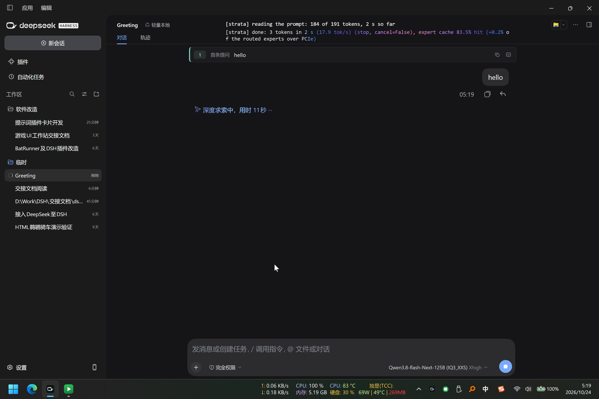
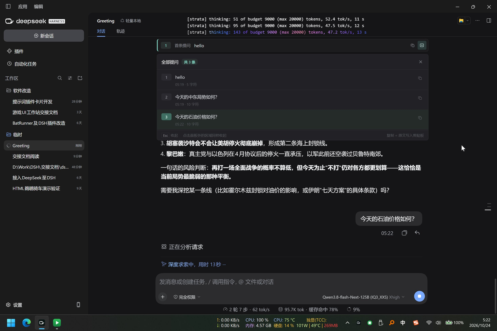
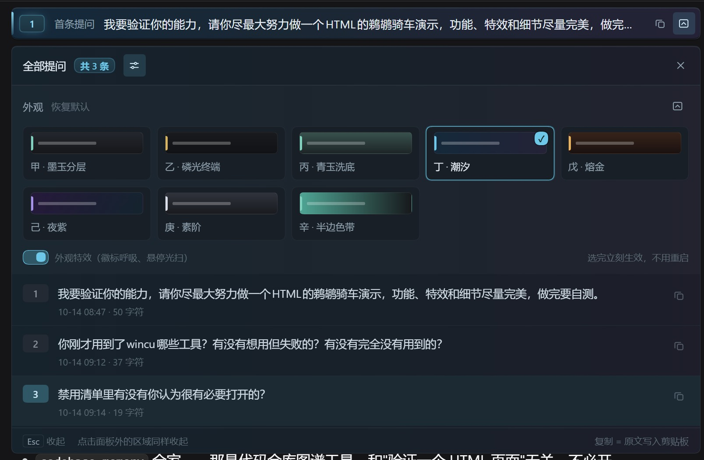

# dsh-first-prompt-bar

[中文](README.zh.md)

This plugin lets you see (and copy) the first prompt you sent in a DSH agent session at a glance, with a collapsible panel listing every prompt you have sent. Designed to be minimal! Works with any DSH client that shows the Web GUI.

## Screenshots

**1 — Collapsed bar.** At the top of the Chat (对话) tab, one pinned row shows the session's first prompt — here `hello` — prefixed by its ordinal and a `首条提问` ("first prompt") tag, with a copy icon and an expand icon on the right. The chat bubble below it (`hello`, sent 05:19) is the normal DSH conversation flow: the bar sits above the conversation and, by design, never scrolls away, no matter how far you scroll.

**2 — Expanded panel.** Clicking the expand icon opens a panel directly under the bar, titled `全部提问 · 共 3 条` ("all prompts · 3 total") with a × close button. It lists exactly the three prompts the user sent — `hello` (05:19, 5 characters), `今天的中东局势如何?` (10 characters), `今天的石油价格如何?` (10 characters) — each row numbered and timestamped with its own copy icon. Model answers are not listed: the long answer about the Mideast ceasefire visible below the panel is part of the normal chat, simply pushed down while the panel is open (it expands inline instead of floating, so nothing is ever hidden behind it). The footer spells out the interaction rules: `Esc 收起` / `点击面板外的区域同样收起` (press Esc or click anywhere outside the panel to collapse), `复制 = 原文写入剪贴板` (copy puts the raw prompt text on the clipboard).

**3 — Appearance picker.** The slider icon in the panel header (left of ×, lit here because the picker is open) opens an appearance picker directly under the header: eight looks, each drawn as a mini preview of the bar, with **Reset** beside the section title `外观` ("appearance"). The look in use — `丁 · 潮汐` here — is outlined and carries a check badge in its corner, and the pinned bar at the top of the shot is wearing exactly that look. The switch on the bottom row turns the motion effects (badge glow, copy flash, hover light sweep) on or off without touching any color; clicking a swatch repaints the bar on the spot — no restart, no reload — and the pick is remembered for the next time you open DSH.

## Usage

| Action | Result |
| --- | --- |
| Bar right, 2nd icon (box with down arrow) | Expand the full-prompt panel; the icon stays lit while it is open |
| Click the same icon again | Collapse |
| × at the right of the panel header | Collapse |
| Click anywhere outside the panel (rest of DSH, message area, composer…) | Collapse |
| Press `Esc` | Collapse |
| Copy icon on the bar | First prompt's raw text goes to the clipboard; the icon ticks to a check mark |
| Hover a panel row and click its small copy icon | That prompt's raw text goes to the clipboard |
| Slider icon in the panel header (left of ×) | Open the appearance picker; click the same icon again to close |
| Click a swatch in the appearance picker | The bar takes that look immediately — no restart — and the choice is remembered |

The panel lists only prompts **you** sent — injected context, wake-up context, time context and compact checkpoints are all excluded — oldest first; prompts later overwritten are dropped. Everything stays local: records live in `localStorage` under the session id, no network requests, no telemetry.

**Eight switchable looks.** The picker holds eight presets (ink, phosphor, jade, tide, ember, dusk, slate, half-band), each shown as a mini preview of the bar. Switching is instant and needs no restart — every look's CSS ships in the plugin and picking one only changes a class — and your pick is remembered in `localStorage` next to the prompt records. **Reset** returns to the default (ink). The switch in the picker's footer turns the motion effects (badge glow, copy flash, hover light sweep) on or off without changing any color; a system-wide "reduce motion" setting is respected automatically. All colors are the plugin's own CSS variables (`--fpb-*`), so you can override any of them from your own user styles.

## Installation

- In the plugin market (dshmarket), install `dsh-first-prompt-bar` with one click; or run `dsh plugin add dsh-first-prompt-bar`.
- **After installing, restart the whole DSH application.** `Ctrl+R` / `F5` only reload the page; the client module graph is fixed when the web service starts, so without a restart the old code keeps running.
- Requires DSH `>=0.2.1-rc.1` (developed and tested on DSH 0.2.1-rc.2 / DSH Desktop 0.12.1).

## Known limitations

- **Old sessions (created before this plugin was installed): the first prompt may not come back.** This is a DSH-side limit, not a plugin bug: in long sessions, compaction prunes the bodies of very old events out of the data the client can read. In that case the bar shows the oldest prompt that can still be recovered, and an orange **Incomplete (不完整)** badge appears next to it (hover for the reason). You can manually click **Load older** in that session, refreshing the bar's prompt record until the session's true first prompt appears — once it does, the record is properly saved and never changes again (that is the first prompt in the theoretical sense).

## License

MIT
